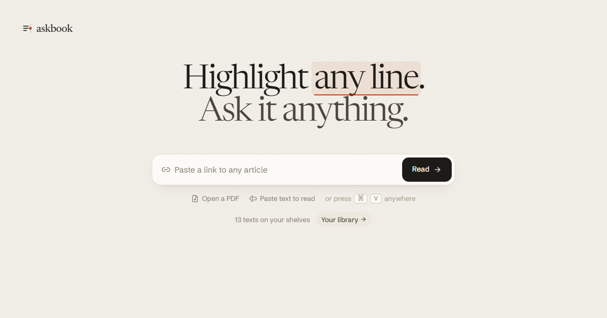

  

<h1 align="center">Gloss</h1>

A reader for articles, chapters and PDFs: select any line, start typing, and a local model writes the answer in the margin beside it, citing paragraphs you can check. Single machine: no accounts, no cloud database.

## Tech stack

- Next.js 16 (App Router, Turbopack), React 19, Tailwind v4, Zustand. Local-first: texts live in IndexedDB, and glosses, highlights and settings in localStorage.
- One machine, one store: the shelf, texts, highlights, notes, glosses and reading progress also sync to a SQLite file on the server (`$GLOSS_DATA_DIR/gloss.db`, else `.data/gloss.db` in this checkout — `lib/db.ts`, `app/api/sync`), so a cleared browser loses nothing.
- Your own notes on any highlight, in the margin beside the model's (`Lens.tsx`, `Margin.tsx`). A daily review on the home page brings back five of your highlights, spaced like flashcards (`lib/review.ts`); the shelf searches every highlight and note, and exports them all as Markdown files ready for Obsidian (`lib/export.ts`, `lib/zip.ts`).
- The library (`/library`, `components/library/`): everything on your shelf as a bookcase, arranged by topic, recency, colour or length, with a topic view of plates and a 3D book that comes off the shelf. Any text can be renamed (click its title, there or in the shelf sheet), and the three samples can be taken off the shelf, remembered per device (`hiddenSamples` in `lib/library-prefs.ts`). Every new text is sorted onto one of 24 fixed topics, with a few tags, by one model call (`lib/shelve.ts`, `app/api/shelve`); texts from before are sorted the first time the library opens (`lib/shelving.ts`). Covers are drawn placeholders in the topic's ink; topic plates and icons are generated art in `public/library/`.
- Newsreader and Schibsted Grotesk, plus Literata and Atkinson Hyperlegible as optional reading faces; six themes, four pens and four highlighters from CSS variables, applied before first paint.
- Every model call goes to a local magpie gateway (`http://127.0.0.1:3425`, OpenAI-compatible) over raw SSE fetch (`lib/together.ts`). Answers stream; the model list and the routing groups `group/flash-models` (Quick) and `group/pro-models` (Deep) are allow-listed in `lib/models.ts`.
- Web search with Exa (`lib/search.ts`): the model gets a `web_search` tool and decides when to look something up (a named person, organisation, work, or anything newer than the text); Fact-check always searches. On by default, the Web toggle turns it off. Results are cited as [1], [2] beside the text's own [¶n].
- The whole text goes in the system prompt with `[¶n]` numbers, so follow-ups hit the model's prefix cache and answers cite paragraphs.
- Anchors are block id plus character offsets, rendered as React marks; margin layout and leader lines in `components/reader/Margin.tsx`.
- Import: links through `@mozilla/readability` on `linkedom` (with a private-address guard), keeping figures (by their original URL, loaded without a referrer) and data tables (which the model reads too); plus pasted text and `.txt`/`.md`. Posts and videos (X, Threads, Bluesky, YouTube and the like) are turned away with a pointer to Paste text (`notAnArticle` in `lib/fetch-article.ts`). Two bookmarklets in the library's Add panel open any page at `/?url=` (read now) or `/?save=` (shelve for later); the same panel takes a Pocket, Instapaper or Raindrop export and saves its links 100 at a time.
- PDFs (`lib/pdf.ts`): LiteParse, Rust compiled to WebAssembly (`public/liteparse-2.15.1.wasm`, copied from `@llamaindex/liteparse-wasm`), reads the text layer in the browser, columns, headings, lists and tables, in milliseconds. Pages with no usable text (scans, garbled glyphs) are rendered and read by a vision model through magpie (`app/api/pdf-page`, `MAGPIE_VISION_MODEL`). The original PDF is kept in IndexedDB. Pages whose layout looks hard (columns, tables, maths) are read again in the background (`lib/upgrade.ts`, mode "layout" in `app/api/pdf-page`) and swapped in one at a time, while nothing cites their paragraphs yet.

## Running

1. Start magpie on this machine (it listens on `127.0.0.1:3425` by default).
2. Install: `npm install`
3. Copy `.env.example` to `.env.local`. Defaults work as they are; `EXA_API_KEY` is the only one worth adding, and Fact-check stays inside the text without it.
4. Run: `npm run dev`, open http://localhost:3100, and paste a link (or press ⌘V anywhere), or open the library and shelve a few classics.
5. Read: select text and type to ask, `/` asks about the whole text, `j` and `k` walk paragraphs, `B` glosses the whole text, `F` is focus mode, `?` lists every key.
6. Check: `npm run lint`.

## Desktop (Electron)

The app can run as a desktop window on Windows and macOS. Electron is only a shell: the same Next.js server runs inside it, so SSE answers, sync and SQLite are unchanged.

- Develop: `npm run dev` in one terminal, `npm run electron:dev` in another. The window attaches to the dev server on :3100.
- Build installers later: `npm run dist` (runs `next build`, then `electron-builder` → `dist/`). macOS installers must be built on a Mac.
- Data location: in a packaged build the SQLite file lives at the OS user-data directory (`%APPDATA%/Gloss/gloss.db` on Windows, `~/Library/Application Support/Gloss/gloss.db` on macOS) instead of `.data/`, so app updates never touch it. The env var `GLOSS_DATA_DIR` sets it; the Electron main process sets it to `app.getPath("userData")` for the server it forks.
- Still needed: magpie on `127.0.0.1:3425`. The desktop shell does not start it.

## Roadmap

- [ ] ship it as a browser extension that opens the same margin on any page
- [ ] let a gloss compare two passages you pick at once

## Security

`MAGPIE_API_KEY` and `EXA_API_KEY` stay server side; nothing secret reaches the browser. Link import refuses private, loopback and link-local addresses on every redirect hop.

Samples, all public domain via Project Gutenberg: Huxley, "On a Piece of Chalk" (1868); Schopenhauer, "On Thinking for Oneself" (trans. T. Bailey Saunders); Thoreau, "Reading" from Walden (1854). Rebuild them with `scripts/build-samples.mjs`; dashes are normalized to plain punctuation.
